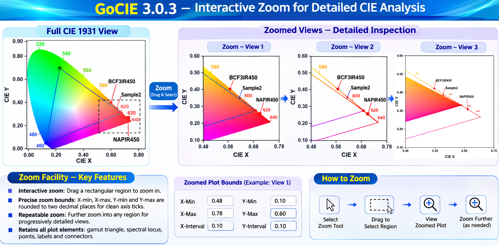
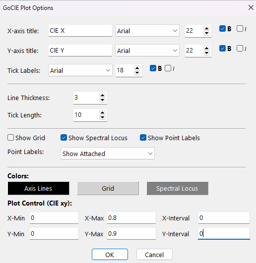
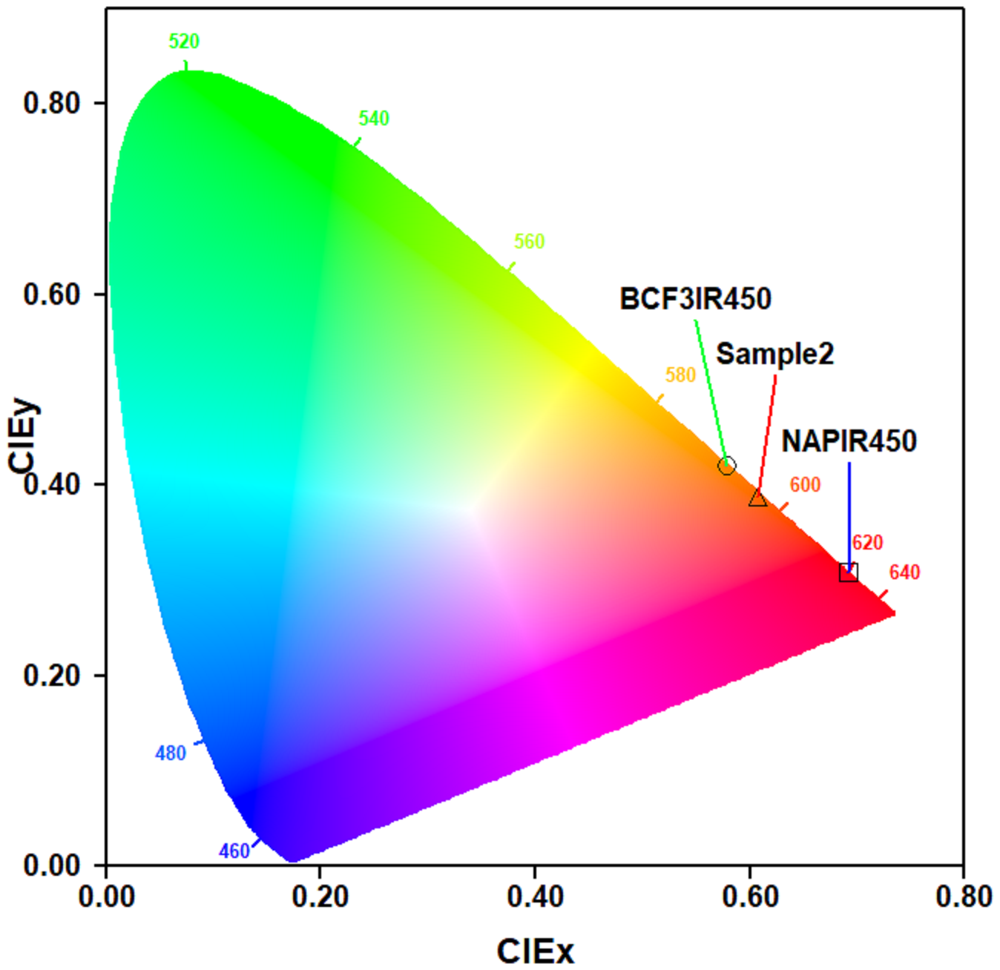
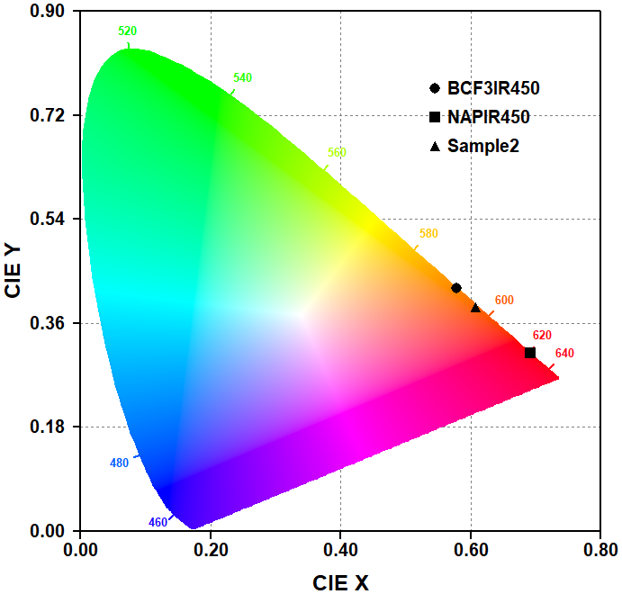

# GoCIE 3.0.3

# **What's New**

## Overview

Since GoCIE 3.0.2, the plotting interface and view-management workflow have been refined with particular attention to interactive zooming, axis scaling, point annotations, and export settings. These additions build on the color-standard, custom-gamut, and spectral-point features introduced in GoCIE 3.0.2 while retaining the established plotting, printing, exporting, copying, and data-handling workflow.

## 1. Interactive Plot Zoom

The plot supports zooming into a selected rectangular region of the CIE chromaticity diagram.

- Select a region of the plot to focus on a smaller range of CIE \(x,y\) coordinates.
- The selected screen region is converted into CIE coordinates and applied as the new plot bounds.
- Zooming allows crowded spectral regions and closely spaced chromaticity points to be inspected in greater detail.

### Precision of zoom bounds

The four bounds used for a zoomed view—X-min, X-max, Y-min, and Y-max—are rounded to two decimal places before the new view is applied. This avoids carrying excessive coordinate precision from the screen-to-CIE conversion into the axis limits and helps the automatic tick-interval selection produce cleaner scales.

If rounding collapses the selected region to zero width or height, the zoom is not applied.

## 2. X- and Y-Axis Tick-Interval Control

Plot Options now provides explicit X- and Y-tick interval settings alongside the corresponding axis limits.

The bounds and intervals are arranged in two rows:

| X-min | X-max | X-interval |
|---|---|---|
| Y-min | Y-max | Y-interval |

- Users can set the minimum and maximum values for each axis.
- Users can specify the tick interval independently for the X and Y axes.
- An interval of `0` selects automatic interval determination.
- The controls are grouped together to make the relationship between axis bounds and tick spacing clear.

### Improved automatic tick selection

The automatic interval calculation evaluates candidate intervals intended to give readable, evenly spaced tick marks. The selection considers conventional interval values and a target range of approximately four to seven divisions. The interval is normalized to two significant digits to avoid awkward values caused by floating-point calculations.

The exact interval chosen depends on the displayed axis range and should be checked against the resulting plot when using unusually narrow or irregular ranges.

## 3. Point-to-Label Connector Styling

The line joining a plotted CIE point to its text label can be styled independently of the point marker.

Available controls include:

- **Connector color**
- **Connector line width**
- A default connector width consistent with the wavelength-label tick-line width

The settings are available through point management and apply to the individual point. This makes it easier to distinguish labels when several points are close together or when a label must be positioned away from its point.

## 4. Improved Point Annotation and Label Placement

Point annotation controls have been refined to make labels easier to position and interpret.

- Newly added points receive appropriate initial label offsets rather than being placed at an unrelated plot corner.
- Label positioning is intended to remain usable after adding points through the available point and spectrum workflows.
- The connector between a point and its label provides a visible association when the label is displaced from the marker.

Existing point-label management and the **Show Labels as List** function are retained.

## 5. Export Scale Menu Refinement

The export-scale choices are now presented consistently in both the main menu and the plot context menu.

- The available explicit scale choices are **2×, 3×, 4×, and 5×**.
- **1×** is the default scale and is therefore not listed as a separate menu choice.
- Selecting a scale updates the check mark in both menus so that the active setting is visible regardless of which menu is opened.

## 6. Save View and Restore View

Saved plot views retain the view settings needed to restore the plot configuration.

The save/load workflow has been updated to address restoration of wavelength-tick visibility, including the option to show wavelength ticks without wavelength labels. The intention is for the restored view to reproduce the saved visibility setting rather than silently reverting to a default.

Because this setting depends on the full load-and-render sequence, verify the behavior in the released build by saving a view with the option enabled and disabled, then reopening each saved view.

## Summary

The changes since GoCIE 3.0.2 focus on:

1. Interactive rectangular zooming of the CIE plot.
2. Two-decimal rounding of zoom bounds before applying the zoom.
3. User-defined X- and Y-axis tick intervals, with automatic selection when the interval is set to `0`.
4. Improved automatic tick-interval selection using conventional interval values and two-significant-digit normalization.
5. Configurable point-to-label connector color and width, independent of the point marker.
6. Improved initial placement and association of point labels.
7. Consistent export-scale choices and check marks in both the main and context menus.
8. Improved persistence of plot-view settings, including wavelength-tick visibility.

These refinements improve the inspection and presentation of CIE chromaticity plots, particularly when zooming into dense regions or annotating closely spaced spectral points.

